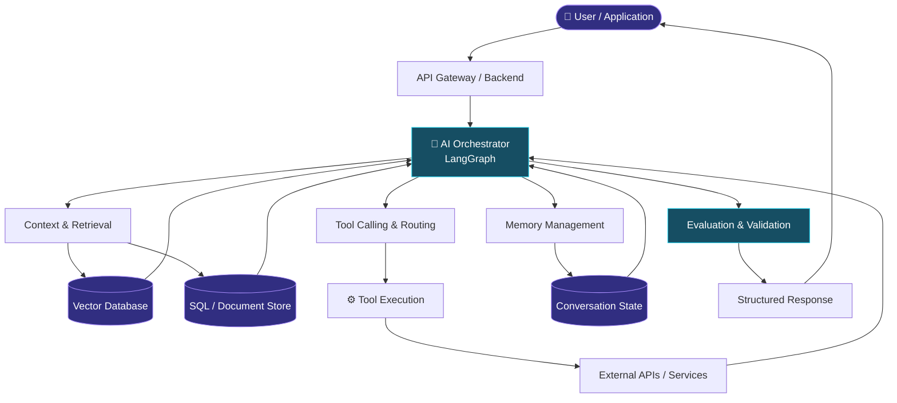

<!-- ========================================================= -->
<!-- SHANE | COSMIC AI ENGINEER PROFILE                        -->
<!-- ========================================================= -->

<div align="center">


<br/>

# ✦ SHANE // SYSTEM ARCHITECT & AI FOUNDER ✦

### Building Intelligence. Engineering Possibilities.

*Turning imagination into intelligent, scalable software.*

<br/>

<a href="https://github.com/shane9AA">
  
</a>
<a href="https://anovation.in">
  
</a>

</div>

---

## 🌌 The Philosophy

> *Discipline today, freedom tomorrow. Imagination is the blueprint; engineering is how we bring it to life.*

I'm **Shane** — a developer, founder, and product builder fascinated by the intersection of Artificial Intelligence, software engineering, and human imagination.

I enjoy working across the entire product lifecycle: from understanding an idea and designing its architecture to engineering intelligent systems and turning them into usable products.

My focus is on building software that doesn't just respond, but can **reason, retrieve information, make decisions, and execute tasks.**

```yaml
identity:
  name: Shane
  role: AI Engineer | Founder | Product Builder
  philosophy: "Think deeply. Architect intelligently. Execute relentlessly."

mission:
  - Build intelligent AI-powered products.
  - Engineer autonomous agents and RAG systems.
  - Design reliable and scalable software architectures.
  - Turn ambitious ideas into real-world products.

interests:
  - Artificial Intelligence & AGI
  - Agentic Systems & Multi-Agent Architecture
  - Distributed Systems & System Design
  - Product Engineering & Entrepreneurship
```

---

## 🧠 AI Engineering & Intelligent Systems

*Building systems that understand context, retrieve knowledge, reason, and take action.*

<div align="center">


</div>

| Engineering Layer | Technologies & Concepts |
|:--|:--|
| **LLMs & Orchestration** | LangChain, LangGraph, Prompt Engineering, Structured Outputs |
| **Agentic AI** | Tool Calling, Function Calling, Agentic Workflows, Multi-Agent Systems |
| **RAG Architecture** | Embeddings, Semantic Search, Hybrid Retrieval, Reranking, Chunking |
| **Vector Databases** | Qdrant, Pinecone, pgvector, Chroma |
| **Machine Learning** | Scikit-learn, Pandas, NumPy, Data Modeling |
| **Deep Learning** | Neural Networks, Backpropagation, PyTorch |
| **AI Evaluation** | RAG Evaluation, LLM Evaluation, Tracing, Observability |

### ⚡ The Agentic Architecture



---

## 🏗️ System Design & Backend Engineering

*Because intelligent software needs intelligent infrastructure.*

| Domain | Architecture & Technologies |
|:--|:--|
| **Backend Engineering** | Python, FastAPI, Node.js, REST APIs |
| **Databases** | PostgreSQL, MongoDB, Redis |
| **System Architecture** | Microservices, Modular Monoliths, Event-Driven Design |
| **Communication** | REST, WebSockets, Server-Sent Events |
| **Caching & Performance** | Redis, Query Optimization, Async Processing |
| **Infrastructure** | Docker, AWS, Linux |
| **DevOps & Monitoring** | GitHub Actions, CI/CD, Logging, Metrics |
| **Currently Exploring** | Kubernetes, Prometheus, Grafana, Advanced MLOps |

### Infrastructure & Engineering

<div align="center">


</div>

---

## ⚔️ Full-Stack Development Arsenal

*From backend architecture to polished user experiences.*

<div align="center">


</div>

**Frontend:** React, Next.js, TypeScript, Tailwind CSS, Responsive UI.

**Backend:** Python, FastAPI, Node.js, REST APIs, Authentication.

**Data:** PostgreSQL, MongoDB, Redis, Data Processing.

**Engineering:** Git, GitHub, Docker, Linux, AWS.

---

## 🚀 What I'm Building Towards

I believe the next generation of software will be built around intelligent systems rather than isolated applications.

- **Agentic Operating Systems:** AI agents capable of managing complex workflows.
- **Personal AI:** Context-aware assistants that understand users and their environments.
- **Intelligent SaaS:** Turning repetitive business processes into autonomous workflows.
- **AI Infrastructure:** Building reliable, observable, and scalable AI systems.
- **Product Entrepreneurship:** Creating technology products that solve meaningful problems.

---

## 📊 GitHub Telemetry

<div align="center">


</div>

<div align="center">


</div>

---

## 🌠 Beyond The Code

I don't see engineering as just writing code.

I'm interested in understanding how things work, challenging existing limitations, exploring ideas, and creating something that didn't exist before.

**Think beyond the obvious. Build beyond the ordinary.**

<div align="center">


### ✦ "The future is not something we wait for. It's something we engineer." ✦

<sub>Designed with curiosity. Built with discipline. Driven by imagination.</sub>

</div>
