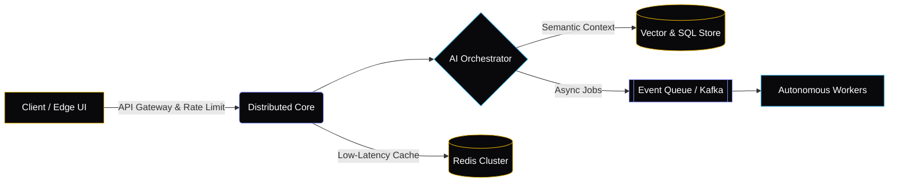

<!-- ===================================================================== -->
<!-- HERO BANNER                                                           -->
<!-- ===================================================================== -->
<div align="center">
  
</div>

<h1 align="center">✦ SHANE // SYSTEM ARCHITECT & AI FOUNDER ✦</h1>

<p align="center">
  
</p>

<div align="center">
  
  
  
</div>

<br/>

---

### 🌑 The Manifesto (`core_philosophy.yml`)

> *"Discipline today, freedom tomorrow. Imagination is the blueprint; AI and engineering are the hands that build it."*

I am **Shane**—a **developer, founder, and product builder** driven by a singular obsession: **making dreams come true through technology**. I operate across the entire stack—from low-level distributed system design to autonomous multi-agent AI workflows—to close the gap between abstract human ideas and living, breathing software products.

```yaml
entity:
  name: "Shane"
  class: "Founder & Full-Spectrum Product Architect"
  core_directive: "Imagination ──▶ [ System Design + AI ] ──▶ Reality"

capabilities:
  - "End-to-End 0→1 Product Conception, Architecture & Deployment"
  - "Autonomous AI Agents, RAG Pipelines & Multi-Modal LLM Systems"
  - "High-Throughput Distributed Backends & Event-Driven Infrastructure"
  - "Tactile, High-Craft Interfaces Built for Speed & Clarity"

operating_principles:
  discipline: "Relentless execution over passive theory."
  architecture: "Design for scale from day zero; keep complexity invisible."
  velocity: "Prototype in hours, ship in days, iterate forever."
```

---

### 🧠 Intelligence & AI Engineering Stack

Building cognitive software that reasons, retrieves, and executes autonomously.

<p align="center">
  
  
  
  
  
  
  
  
</p>

| AI Layer | Technologies & Patterns Used |
| :--- | :--- |
| **LLM Orchestration & Agents** | LangGraph, LangChain, CrewAI, Function Calling, Tool-Use Loops, Multi-Agent Routing |
| **Retrieval & Memory (RAG)** | Hybrid Semantic/Keyword Search, Embeddings, Qdrant, Pinecone, pgvector, Chunking Pipelines |
| **Model Serving & Inference** | vLLM, Ollama, Streaming SSE Tokens, Prompt Caching, Structured JSON Outputs |
| **Applied ML & Vision** | PyTorch, Transformers, Whisper (Audio), Diffusion & Multi-Modal Pipelines |

---

### 🏗️ System Design & Distributed Infrastructure Stack

Architecting resilient, fault-tolerant foundations capable of handling real-world scale.

<p align="center">
  
  
  
  
  
  
  
  
</p>



* **Architecture Patterns:** Microservices, Event-Driven Pipelines, CQRS, WebSockets / Real-Time Streaming, Multi-Tenant SaaS Isolation.
* **Data & Caching:** PostgreSQL, MongoDB, Redis (Pub/Sub & Distributed Locks), S3 Object Storage.
* **DevOps & Reliability:** CI/CD GitHub Actions, Zero-Downtime Container Deployments, Load Balancing, Observability & Rate Limiting.

---

### ⚔️ Full-Stack Developer Arsenal

Languages, frameworks, and tools used to craft products from bare metal to pixel.

<div align="center">
  <a href="https://skillicons.dev">
    
  </a>
</div>

* **Frontend Craft:** Next.js, React, TypeScript, Tailwind CSS, Framer Motion, Real-Time Streaming UIs.
* **Backend Engines:** Python (FastAPI), Node.js, Go, REST & GraphQL APIs, Authentication & RBAC.

---

### 📊 Telemetry, Activity & Contribution Graphs

<!-- ===================================================================== -->
<!-- REPLACE "YOUR_GITHUB_USERNAME" IN ALL 4 URLS BELOW                    -->
<!-- ===================================================================== -->
<div align="center">
  
  
</div>

<div align="center">
  
</div>

<div align="center">
  
</div>

---

<div align="center">
  <sub><b>"Knowledge is your greatest tool. Build the future you imagine."</b> — Shane ✦</sub>
</div>
